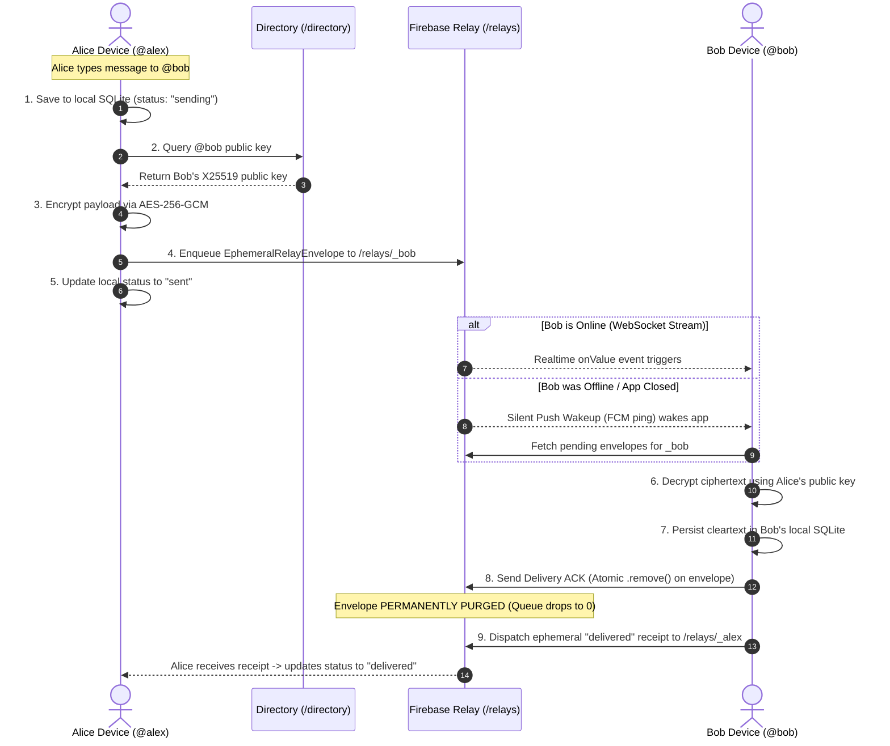

# Nest — Server & Networking Architecture Guide

> **Document Version:** 1.0.0  
> **Target Application:** Privacy-First Multi-User Messaging System (`Nest`)  
> **Core Principle:** *"The phones own the conversation. The server only helps the phones communicate."*

---

## 1. Executive Overview

`Nest` is designed as a **local-first, multi-user messaging system** with end-to-end encryption (E2EE). Users are identified, discovered, and addressed exclusively through unique **`@username`** handles.

### Core Guarantees:
1. **Zero Personally Identifiable Information (PII):** No phone numbers, email addresses, contact list permissions, or real names are ever requested or stored on the server.
2. **True End-to-End Encryption (E2EE):** All message contents, reactions, notes, and media attachments are encrypted on the sending device and can only be decrypted by the intended recipient.
3. **Zero Server Retention (Ephemeral Relay):** The remote server acts solely as a temporary signaling and message relay. Once a recipient device acknowledges receipt (ACK), the ciphertext envelope is **permanently purged** from the server.
4. **Local Device Ownership:** Permanent chat history exists exclusively in each user device's local SQLite database (powered by Drift).

---

## 2. Server Infrastructure & Topology

The server infrastructure consists of lightweight, untrusted cloud transport components (hosted on Firebase):

```
┌────────────────────────────────────────────────────────────────────────┐
│                        FIREBASE CLOUD RELAY                            │
│                                                                        │
│   ┌───────────────────────────┐      ┌─────────────────────────────┐   │
│   │     /directory/{user}     │      │   /relays/{recipient}/{id}  │   │
│   │  Public Key Discovery &   │      │   Ephemeral Ciphertext      │   │
│   │  Presence Registry        │      │   Queue (Purged on ACK)     │   │
│   └───────────────────────────┘      └─────────────────────────────┘   │
│                 │                                   │                  │
│                 └─────────────────┬─────────────────┘                  │
│                                   │                                    │
│                     ┌───────────────────────────┐                      │
│                     │       /media_blobs        │                      │
│                     │  Ephemeral Encrypted      │                      │
│                     │  Media Blob Storage       │                      │
│                     └───────────────────────────┘                      │
└───────────────────────────────────┬────────────────────────────────────┘
                                    │
            ▲                       │                      ▲
            │ (TLS 1.3 / HTTPS)     │ (TLS 1.3 / HTTPS)    │ (TLS 1.3 / HTTPS)
            │                       │                      │
┌───────────────────────┐           │           ┌───────────────────────┐
│     DEVICE A          │           │           │     DEVICE B          │
│     (@alex)           │           │           │     (@twilight)       │
│                       │           │           │                       │
│  - Local SQLite DB    │           │           │  - Local SQLite DB    │
│  - Hardware Keystore  │           │           │  - Hardware Keystore  │
│  - E2EE Engine        │           │           │  - E2EE Engine        │
└───────────────────────┘           │           └───────────────────────┘
                                    │
                        ┌───────────────────────┐
                        │     DEVICE C          │
                        │     (@charlie)        │
                        │                       │
                        │  - Local SQLite DB    │
                        │  - Hardware Keystore  │
                        │  - E2EE Engine        │
                        └───────────────────────┘
```

---

## 3. Server Data Schemas & Structure

All server data is hosted in Firebase Realtime Database and Cloud Storage under strict isolation paths:

### 3.1. Public User Directory (`/directory/{username}`)
Enables multi-user discovery and cryptographic key exchange by username:

```json
{
  "directory": {
    "_bob": {
      "accountId": "acc_1729000000_12345",
      "username": "@bob",
      "publicIdentityKey": "B64_ENCODED_X25519_PUBLIC_KEY==",
      "fcmToken": "optional_fcm_token_for_silent_wakeups",
      "lastSeen": "2026-10-19T10:00:00.000Z"
    },
    "_sarah": {
      "accountId": "acc_1729000000_67890",
      "username": "@sarah",
      "publicIdentityKey": "B64_ENCODED_X25519_PUBLIC_KEY==",
      "fcmToken": null,
      "lastSeen": "2026-10-19T10:05:00.000Z"
    }
  }
}
```

* Keys are sanitized (e.g., `@bob` ➔ `_bob`) to conform to Firebase key naming rules.
* Never contains private keys, passwords, or recovery mnemonic phrases.

### 3.2. Ephemeral Ciphertext Relay (`/relays/{recipientUsername}/{messageId}`)
Temporary holding queue for encrypted envelopes awaiting delivery:

```json
{
  "relays": {
    "_bob": {
      "msg_987654321": {
        "id": "msg_987654321",
        "sender_id": "@alex",
        "recipient_id": "@bob",
        "ciphertext": "{\"v\":1,\"spk\":\"...\",\"nonce\":\"...\",\"ct\":\"...\",\"mac\":\"...\"}",
        "timestamp": 1729339200000,
        "expires_at": 1729425600000,
        "envelope_type": "message"
      }
    }
  }
}
```

### 3.3. Ephemeral Media Storage (`/media_blobs/{blobId}`)
* Stores encrypted binary bytes of photos, voice notes, and videos.
* The decryption key is generated randomly per-media, wrapped with the recipient's public key, and sent inside the message ciphertext payload.
* Media blobs have a 24-hour Time-To-Live (TTL) and are permanently purged the moment the recipient downloads them.

---

## 4. End-to-End Encryption (E2EE) Protocol

The application uses state-of-the-art cryptographic primitives (`package:cryptography`):

1. **Identity Key Generation:** During account registration, an **X25519 keypair** is generated. The private key is saved directly into the device's hardware Keystore / Keychain via `flutter_secure_storage`. The public key is published to `/directory`.
2. **Key Agreement (Diffie-Hellman):**
   $$\text{SharedSecret} = \text{X25519}(\text{AlicePrivateKey}, \text{BobPublicKey})$$
3. **Key Derivation (HKDF-SHA256):**
   A unique 256-bit symmetric encryption key is derived using HKDF with salt and application info tags:
   $$\text{MessageKey} = \text{HKDF}(\text{SharedSecret}, \text{salt}=\text{info}=\text{"nest_e2ee_v1"})$$
4. **Authenticated Encryption (AES-256-GCM AEAD):**
   The plaintext message is encrypted using AES-256-GCM with a fresh random 12-byte IV/nonce and a 16-byte MAC authentication tag.
5. **Fail-Closed Guarantee:** If the recipient's public key cannot be resolved from the local database or remote directory, transmission is immediately aborted with a `SecurityException`, preventing any plaintext leakage.

---

## 5. Multi-User Message Lifecycle & Networking Flow

Here is the exact step-by-step workflow when **@alex** sends a message to **@bob**:



---

## 6. Username Tracking & Multi-User Conversations

The system manages multi-user communication seamlessly without a central server-side user database:

1. **Addressing by Username:** Every message envelope specifies `sender_id: "@username"` and `recipient_id: "@username"`.
2. **Dynamic Inbound Conversation Creation:**
   - When Bob receives a message from a new sender (e.g. `@frank`), Bob's `SyncService` decrypts the message and saves it to local SQLite.
   - `LocalConversationRepository` dynamically scans distinct chat partners from the SQLite database.
   - `@frank` automatically appears at the top of Bob's Inbox with their latest message snippet and unread badge.
3. **Outgoing Conversation Initiation:**
   - Tapping the `+` Floating Action Button in the Inbox opens the **"Start a Conversation"** dialog.
   - Entering any valid `@username` resolves their public key from `UserDirectoryService` and initializes an encrypted conversation.
4. **Partner-Independent Couple Space (Love Connection):**
   - Users can hold multiple conversations with different usernames in their Inbox.
   - An optional **Love Connection** can be established with exactly 1 special partner, unlocking couple-specific features (Milestone counters, Sealed Love Notes, Floating Hearts bursts) in a dedicated space while preserving standard multi-user chatting for all other contacts.

---

## 7. Security Rules (`firebase_security_rules.json`)

Server-side Firebase rules enforce access boundaries and validate payloads:

```json
{
  "rules": {
    "relays": {
      "$recipientId": {
        ".read": true,
        "$messageId": {
          ".write": true,
          ".validate": "newData.hasChildren(['id', 'sender_id', 'recipient_id', 'ciphertext', 'timestamp', 'expires_at'])"
        }
      }
    },
    "directory": {
      ".read": true,
      "$username": {
        ".write": true,
        ".validate": "newData.hasChildren(['accountId', 'username', 'publicIdentityKey', 'lastSeen'])"
      }
    }
  }
}
```

* **`/relays` Rules:** Only valid ciphertext envelopes containing all required metadata and expiry fields can be written. Read access is scoped per recipient ID.
* **`/directory` Rules:** Enforces that only profiles with valid account identifiers and public identity keys can be registered.
* **Zero Plaintext Rule:** The server never receives or validates message contents, ensuring absolute cryptographic privacy even in the event of server compromise.
